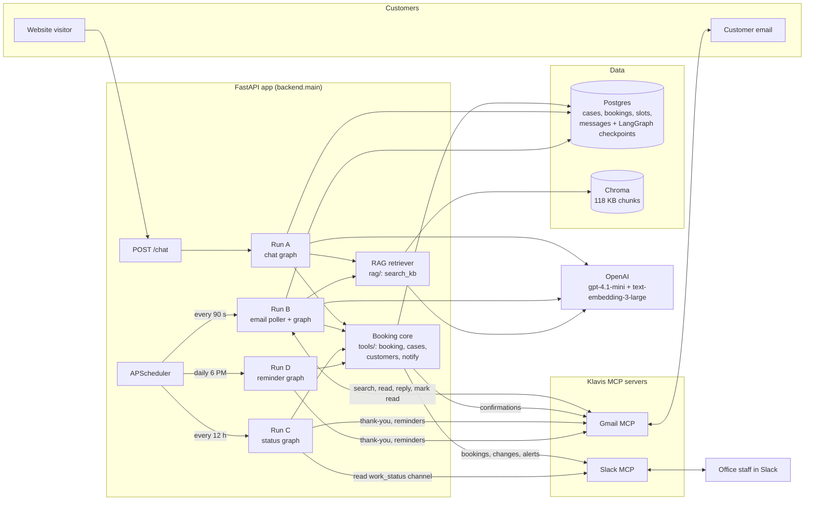
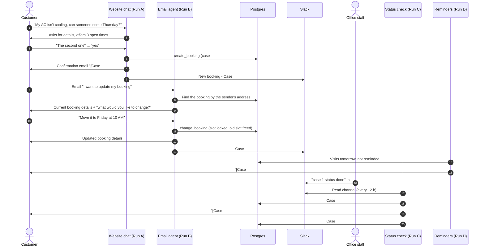
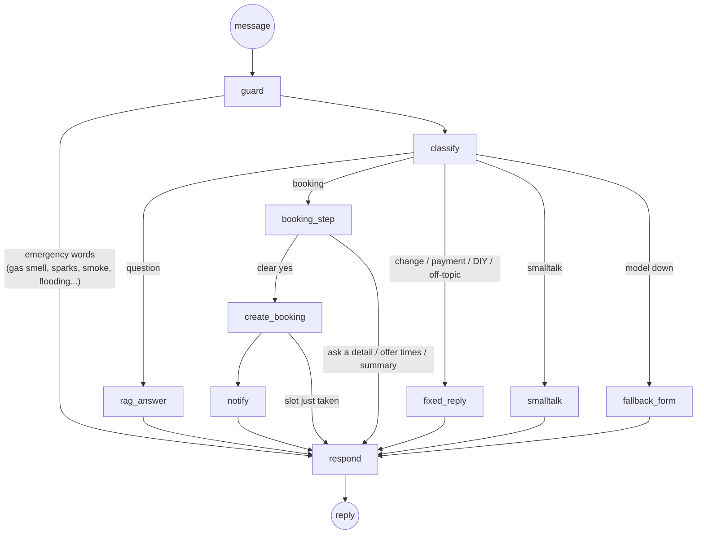
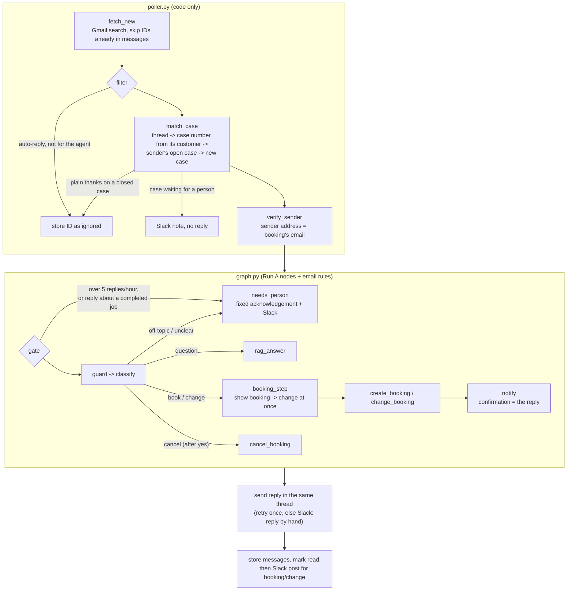
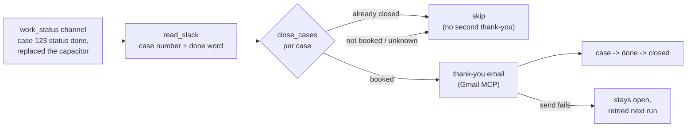
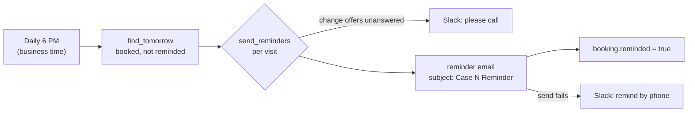
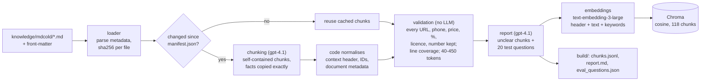
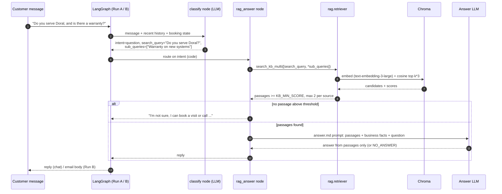
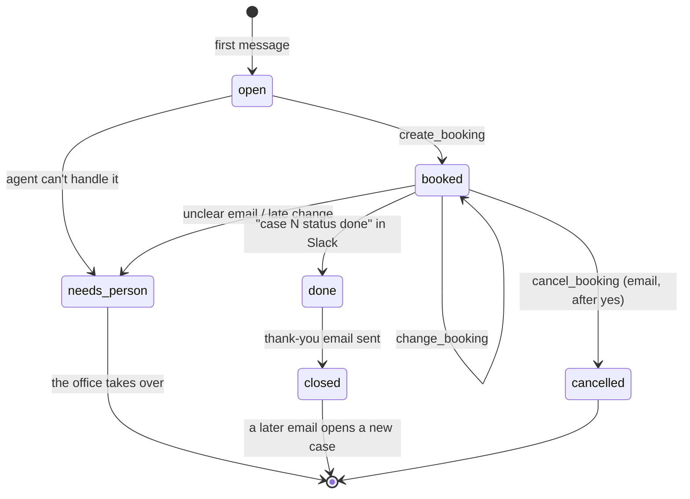

# Speed-to-Lead (hvacX)

An AI front desk for **MD Cold Services**, an HVAC contractor in South Florida. A customer can ask a
question or book a technician visit **in the website chat** or **by email**. The office follows every
booking in **Slack**. Finished jobs reported in Slack get a thank-you email, and every visit gets a
reminder the day before.

All channels share one **booking core** (customers, cases, slots, bookings in Postgres) and one
**knowledge base** (RAG over the company's own documents). The agents are **LangGraph** graphs, and
Gmail and Slack are reached through **MCP** servers. The LLM only classifies messages, extracts
details and words the answers. Code makes every decision that changes data or reaches a customer.

| | |
|---|---|
| **Plan** | [docs/plan.md](docs/plan.md): full design, rules and acceptance checks |
| **Scope** | [docs/](docs/): original scope document |
| **Status** | Phase 1 complete (Runs A–D). Phase 2 (WhatsApp, Run E) and the embeddable widget are next |

---

## Contents

1. [What it does](#what-it-does)
2. [System architecture](#system-architecture)
3. [A customer's journey end to end](#a-customers-journey-end-to-end)
4. [Run A: website chat](#run-a-website-chat)
5. [Run B: email agent](#run-b-email-agent)
6. [Run C: job status from Slack](#run-c-job-status-from-slack)
7. [Run D: day-before reminders](#run-d-day-before-reminders)
8. [Knowledge base (RAG)](#knowledge-base-rag)
9. [Case lifecycle](#case-lifecycle)
10. [Guardrails](#guardrails)
11. [MCP integrations](#mcp-integrations)
12. [Data model](#data-model)
13. [Tech stack](#tech-stack)
14. [Project layout](#project-layout)
15. [Getting started](#getting-started)
16. [Configuration](#configuration)
17. [Testing and evaluation](#testing-and-evaluation)
18. [Known limitations](#known-limitations)
19. [Roadmap](#roadmap)

---

## What it does

| Run | Channel | Trigger | What happens |
|---|---|---|---|
| **A** | Website chat | Each visitor message (`POST /chat`) | Answers questions from the KB, collects booking details, offers open times, books after a clear "yes", sends the confirmation email, posts to Slack |
| **B** | Email | Inbox poll every 90 s | Answers enquiries from the KB, books visits, changes or cancels bookings for the customer's own address, hands anything unclear to a person |
| **C** | Slack | Every 12 h (on demand for testing) | Reads the staff `#work_status` channel. For each "case 123 status done" it sends the thank-you email and closes the case, once |
| **D** | Email | Daily at 6 PM (business time) | Reminds every customer with a visit tomorrow, once per booking. Alerts Slack about unanswered change requests |

All four runs are independent. They never call each other and share state only through the database.

---

## System architecture



**Key design choices**

- **The LLM decides wording, code decides actions.** The model returns a structured analysis
  (intent, extracted details, chosen option). Code validates it and performs every booking, status
  change, email and Slack post. Confirmation texts are templates filled in *after* the database write
  succeeded, so the model can never confirm a booking that doesn't exist.
- **Identity comes from code, never from the model.** Tools read `case_id`, `customer_id`, the
  recipient address and `verified` from graph state set by code. A fooled model can only send a bad
  reply; it can't act on another customer's case or email an address it chose.
- **One booking core for every channel.** Chat and email call the same `create_booking`,
  `change_booking` and `cancel_booking`. These run in one transaction with row locks and partial
  unique indexes, so a slot can never be booked twice.
- **Polling instead of webhooks.** Gmail and Slack are read through MCP on a timer, so the system needs
  no public URL, Slack app or Gmail push setup, and runs the same on a laptop as on a server.

---

## A customer's journey end to end



---

## Run A: website chat

One LangGraph thread per chat session (Postgres checkpointer), so a visitor can leave and come back.



| Node | Kind | Role |
|---|---|---|
| `guard` | Code | Emergency keywords (English and Roman Urdu) → the approved safety message + urgent Slack alert, no AI |
| `classify` | LLM | Structured `TurnAnalysis`: intent, name/phone/email/address/problem, date, time, chosen option, yes/no, a standalone search query |
| `rag_answer` | LLM + RAG | Retrieves passages and answers **only** from them, or says it doesn't know and offers a visit |
| `booking_step` | Code | Collects missing details one or two at a time, validates email and phone (E.164), offers up to 3 open times, reads back a summary |
| `create_booking` | Code | Transactional booking; a slot taken meanwhile → new times offered |
| `notify` | Code | Confirmation email (Gmail MCP) and Slack post. A failure alerts staff, never undoes the booking |
| `fixed_reply` | Code | Fixed answers: changes go by email, no payment details in chat, no DIY diagnosis |
| `fallback_form` | Code | Model unavailable → a short form that creates a `needs_person` case |

A test console at `http://localhost:8000/` (dev only) shows each turn's node path, the classifier
output, booking state, Gmail/Slack results and the database.

---

## Run B: email agent

Run B has two parts. The **poller** (plain code) decides *which* emails to handle and *who* sent them.
The **graph** reuses Run A's nodes and holds the conversation, with one LangGraph thread per case.
A customer can therefore reply days later and the conversation continues where it stopped.



**Rules the email agent follows**

| Situation | Behaviour |
|---|---|
| Question about services, prices, areas | Answered from the knowledge base |
| New booking | Same steps as chat. The booking always uses the sender's address, never one typed in the email |
| "I want to update my booking" | Finds the booking by the sender's address and replies with its full details |
| "Move it to Friday at 10 AM" | If that time is open, the booking moves straight away. Otherwise the 3 closest times are offered and a pick moves it. The updated details are emailed, **then** Slack is posted (old → new) |
| Cancel | Asks for a yes, then cancels, frees the slot and posts to Slack |
| Change within 2 hours of the visit | Goes to a person |
| Change from any other address | Nothing changes; the reply asks for the booking's address; Slack is told |
| Unclear or off-topic email | Case → `needs_person`; the customer gets only a fixed acknowledgement; Slack alert; the AI stays silent on that case |
| Reply to a completed job (other than "thanks") | Straight to a person (it may be a warranty callback) |
| Website enquiry-form email | Customer details parsed by code; may ask and book, never change or cancel |
| Auto-replies, newsletters, unrelated mail | Ignored. Only mail to `EMAIL_AGENT_ADDRESS`, replies on a case and mail from customers with an open booking are taken |

Every email the poller looks at is stored by Gmail message ID, so it's read once. Read/unread is not
used to find work, so staff opening the inbox can't hide an email from the agent.

---

## Run C: job status from Slack



Staff write in their own words. A message counts when it names a case number and a done word (done,
completed, finished, closed). "case 124 not done yet" doesn't count.

## Run D: day-before reminders



A moved booking resets `reminded`, so the new time gets its own reminder. Replying to the reminder
reaches Run B with the case number in the subject.

---

## Knowledge base (RAG)

The knowledge base is built from MD Cold Services' own website content: 11 topic files plus one file
per service and product under `backend/knowledge/mdcold/`, with YAML front-matter (title,
category, source URLs). It's chunked by an LLM, checked by code, embedded and stored in Chroma.

### Ingestion pipeline



- **LLM chunking with fact checks.** The chunker writes self-contained chunks, each starting with a
  context header such as `[Business: MD Cold Services | Category: pricing | Topic: Diagnostic fee]`.
  Code then checks that every price, phone number, URL, percentage, licence number and figure in the
  source appears in some chunk unchanged, and that each source line is covered.
- **Search keywords are embedded, not shown.** Each chunk carries customer phrasings ("house is hot")
  that are embedded with it, so everyday wording finds the right passage. The answer model never
  sees them.
- **Incremental.** Unchanged files are not re-chunked. Changing a chunker prompt or model changes
  `CHUNKER_VERSION` and invalidates the cache.

### Retrieval

`search_kb_multi(queries)` embeds each query with the **same** model used for ingestion, then:

1. takes the best `k × 3` candidates by cosine similarity (`KB_TOP_K` = 6);
2. drops anything below `KB_MIN_SCORE` (0.20, tuned on real vs off-topic questions);
3. keeps at most `KB_MAX_PER_SOURCE` (2) chunks per source file, so a FAQ and a service page that say
   the same thing can't fill every slot;
4. merges results across sub-queries for multi-part questions.

No passage above the threshold means **no answer**: the agent says it doesn't know and offers a
visit or the 24/7 phone line instead of guessing.

### How LangGraph talks to the RAG

RAG is not a tool the model can call freely. It's a fixed step in the graph that runs only when
the classifier routes a turn to `rag_answer`:



- The **classifier rewrites** follow-ups into standalone queries ("how much is it?" → "How much is the
  Premium Comfort Plan?") and splits multi-part questions into up to 3 queries.
- The **answer prompt** allows only facts from the passages, copied exactly. It forbids diagnoses and
  invented prices, and returns `NO_ANSWER` when the passages don't contain the answer.
- The **same path** serves chat and email. Run B only passes `channel="email"` so the wording fits an
  email.

### Evaluation results

End-to-end on 51 labelled questions (40 answerable, 11 that the KB must refuse), through the same path
as the chat. Full report: `backend/knowledge/mdcold/build/eval_qa_report.md`.

| Metric | Score |
|---|---|
| Routing to the knowledge base | 98% |
| Retrieval: expected source in top-k | 100% |
| Retrieval: MRR | 0.846 |
| Retrieval: must-include facts in passages | 98% |
| Answer correctness (LLM judge) | 99% |
| Answer faithfulness (no claims beyond passages) | 98% |
| False "not sure" on answerable questions | 0% |
| Correct refusals on unanswerable questions | 100% |
| Invented facts on unanswerable questions | 0% |
| Latency p50 / p95 | 2.96 s / 4.49 s |

---

## Case lifecycle

Every inquiry or job is a **case** ("Case #123"). Every status change goes through
`tools/cases.transition()`, which checks an allowed-transitions table and writes an audit row
(`case_events`). The model never sets a status.



One open case per customer is enforced by a partial unique index.

---

## Guardrails

| Risk | Control |
|---|---|
| Prompt injection in a message or email | Customer text is data. No tool can forward mail or email an address the model picks; recipients are set by code |
| Model confirms something that didn't happen | Confirmations are templates rendered **after** the database write succeeds |
| Someone else changes a booking | Email: sender must be the booking's address (form emails never). Chat: only the same session, within 60 min |
| Double booking | Slot row lock + partial unique indexes (`one active booking per slot`, `one per case`) |
| Invented prices or facts | Answers only from retrieved passages; numbers in reworded replies are checked against the facts given |
| Emergencies | Code-side keyword guard before any LLM call → fixed safety text + urgent Slack alert |
| Email loops and floods | Auto-replies skipped; more than 5 AI replies per thread per hour → a person |
| Payment details | Never requested or accepted |
| Failures | Booking saved even if email or Slack fails; failed sends alert Slack ("confirm/remind by phone"); MCP connection drops are retried once when the request provably wasn't delivered |

---

## MCP integrations

Gmail and Slack are reached through **Klavis Strata MCP** servers using `langchain-mcp-adapters`.
Only the tools listed below are loaded; the rest are ignored.

| Server | Tools offered | Used | Purpose |
|---|---|---|---|
| Gmail | 10 | `gmail_send_email` | Confirmations, replies in thread (`threadId`), thank-you, reminders |
| | | `gmail_search_emails` | Find candidate inbox mail |
| | | `gmail_read_email` | Read a message's whole thread |
| | | `gmail_modify_email` | Mark handled mail as read |
| Slack | 13 | `slack_user_post_message` | Bookings, changes, cancellations, alerts |
| | | `slack_user_list_channels` | Resolve channel names to IDs |
| | | `slack_get_channel_history` | Read `#work_status` for Run C |

List them yourself with `uv run python scripts/list_mcp_tools.py -v`.

---

## Data model

| Table | Holds |
|---|---|
| `customers` | Name, email (unique), phone in E.164 (unique), address |
| `cases` | Status, channel, linked email thread, timestamps |
| `case_events` | Audit trail of every status change and its reason |
| `slots` | Bookable visit times |
| `bookings` | Slot, service, address, problem; `reminded`, confirmation/Slack sent flags, pending change offers |
| `messages` | Every email in and out, by provider message ID (dedupe and reply-rate limit) |
| LangGraph checkpoints | Conversation state per chat session (`web:<session>`) and per email case (`email:<case>`) |

Schema: [backend/src/backend/db/schema.sql](backend/src/backend/db/schema.sql) (idempotent).

---

## Tech stack

| Part | Choice |
|---|---|
| Agents | LangGraph 1.2 (`StateGraph`, `Command` routing, Postgres checkpointer) |
| LLM | OpenAI `gpt-4.1-mini` (Groq supported via `LLM_PROVIDER`), structured output with Pydantic |
| RAG | Chroma (cosine), OpenAI `text-embedding-3-large`, `gpt-4.1` chunking and review |
| API | FastAPI + Uvicorn |
| Database | Postgres 16 (psycopg 3, connection pool) |
| Integrations | Klavis Gmail and Slack MCP servers via `langchain-mcp-adapters` |
| Scheduling | APScheduler (interval and cron jobs inside the app) |
| Templates | Jinja2 (every customer-facing confirmation, reminder and thank-you) |
| Tooling | uv, pytest |

---

## Project layout

```
hvacX/
├── docker-compose.yml                 # Postgres for local development
├── docs/plan.md                       # design, rules, acceptance checks
└── backend/
    ├── knowledge/mdcold/              # KB source documents (+ build/: chunks, reports, evals)
    ├── scripts/                       # seed demo data, terminal chat, list MCP tools, resend notifications
    ├── tests/                         # graph tests (Runs A-D) and offline RAG tests + eval dataset
    └── src/backend/
        ├── main.py                    # FastAPI app; starts the background jobs
        ├── scheduler.py               # APScheduler: email poll, Slack status, reminders
        ├── config.py                  # settings from .env
        ├── api/                       # /chat, /chat/fallback, /health, dev console
        ├── graphs/
        │   ├── common/                # state types, LLM client, checkpointer
        │   ├── run_a_chat/            # chat graph, nodes, prompts
        │   ├── run_b_email/           # poller, email rules, graph (extends Run A)
        │   ├── run_c_slack_status/    # status channel -> thank-you -> close
        │   └── run_d_reminders/       # day-before reminders
        ├── rag/                       # loader, chunking, validation, report, embeddings,
        │                              #   vectorstore, ingest, retriever, evaluate, evaluate_qa
        ├── tools/                     # booking, cases, customers, notify, guardrails, validation
        ├── mcp/                       # MCP client, Gmail and Slack adapters
        ├── db/                        # schema.sql, connection pool, init
        └── templates/                 # email templates, safety message
```

---

## Getting started

**Requirements:** Python 3.12+, [uv](https://docs.astral.sh/uv/), Docker (for Postgres), an OpenAI
API key, and Klavis MCP URLs for Gmail and Slack.

```bash
docker compose up -d db                              # Postgres
cd backend
cp .env.example .env                                 # fill in the keys (see Configuration)
uv sync
uv run python -m backend.db.init_db                  # tables + LangGraph checkpoint tables
uv run python scripts/seed_demo_client.py            # 14 days of demo slots
uv run python -m backend.rag.ingest                  # build the knowledge base (once, or when docs change)
uv run uvicorn backend.main:app --reload             # API + test console at http://localhost:8000/
```

**Background jobs** run inside the app when enabled in `.env`. Each can also be run once by hand for
testing. These commands really send email:

```bash
uv run python -m backend.graphs.run_b_email.poller          # one inbox poll
uv run python -m backend.graphs.run_c_slack_status.graph    # one status-channel check
uv run python -m backend.graphs.run_d_reminders.graph       # one reminder run
uv run python scripts/chat_cli.py                           # chat with Run A in the terminal
```

---

## Configuration

All settings live in `backend/.env` (template: [backend/.env.example](backend/.env.example)).

| Variable | Default | Purpose |
|---|---|---|
| `DATABASE_URL` | | Postgres connection |
| `OPENAI_API_KEY`, `LLM_PROVIDER`, `LLM_MODEL` | `openai`, `gpt-4.1-mini` | Chat model |
| `KLAVIS_GMAIL_MCP_URL`, `KLAVIS_SLACK_MCP_URL`, `KLAVIS_MCP_TOKEN` | | MCP servers |
| `BUSINESS_NAME`, `BUSINESS_PHONE`, `BUSINESS_TZ` | MD Cold Services, (786) 797-6193, America/New_York | Used in every message and for "tomorrow" |
| `SLACK_BOOKINGS_CHANNEL`, `SLACK_URGENT_CHANNEL` | | Where bookings and alerts are posted |
| `EMAIL_POLL_ENABLED`, `EMAIL_POLL_SECONDS` | `false`, `90` | Run B on a timer |
| `EMAIL_AGENT_ADDRESS` | `BUSINESS_INBOX` | New conversations are taken only from mail sent here. With a personal Gmail use a plus address such as `you+hvac@gmail.com` |
| `EMAIL_FORM_SENDERS` | | Website enquiry-form sender addresses |
| `SLACK_STATUS_CHANNEL`, `SLACK_STATUS_ENABLED`, `SLACK_STATUS_HOURS` | (set to `work_status`), `false`, `12` | Run C: the staff channel and how often it's read |
| `REMINDERS_ENABLED`, `REMINDER_HOUR` | `false`, `18` | Run D |
| `LATE_CHANGE_HOURS`, `MIN_LEAD_HOURS` | `2`, `2` | No changes within 2 h of a visit; no slot sooner than 2 h from now |
| `KB_TOP_K`, `KB_MIN_SCORE`, `KB_MAX_PER_SOURCE` | `6`, `0.20`, `2` | Retrieval tuning |

---

## Testing and evaluation

```bash
cd backend
uv run pytest                                # 65 tests, no network: fake LLM, DB, MCP
uv run python -m backend.rag.evaluate_qa     # end-to-end RAG eval (uses the OpenAI API)
uv run python -m backend.rag.evaluate        # retrieval only: hit@k, MRR, threshold suggestion
```

| Suite | Covers |
|---|---|
| `tests/graphs/test_run_a_chat.py` | Chat routing, booking flow, validation, slot taken, emergencies, fallback |
| `tests/graphs/test_run_b_email.py` | Email rules (auto-reply, quoted text, form parsing), show-then-change flow, exact time, unverified sender, cancel with yes, hand-off to a person |
| `tests/graphs/test_run_c_slack_status.py` | Status message parsing, thank-you once, failures stay open |
| `tests/graphs/test_run_d_reminders.py` | Tomorrow's window, mark once, failed send alert, unanswered change alert |
| `tests/rag/` | Offline pipeline checks + the 51-question eval dataset |

---

## Known limitations

- **No DKIM/DMARC check.** The Gmail MCP returns no raw headers, so email changes trust the sender
  address as shown (Gmail's spam filtering drops most forged mail). A header-returning Gmail tool
  would allow a full check.
- **No way back from `needs_person` in the app yet.** The office handles those cases by hand.
- **Polling latency.** Email replies take up to one poll interval (90 s); Slack status up to 12 h, by design.

---

## Roadmap

- **Embeddable chat widget** for the production website.
- **Run E: WhatsApp** (phase 2): same agent and tools through the WhatsApp Cloud API, with templates
  outside the 24-hour window.
- A Slack command to hand a `needs_person` case back to the AI.
