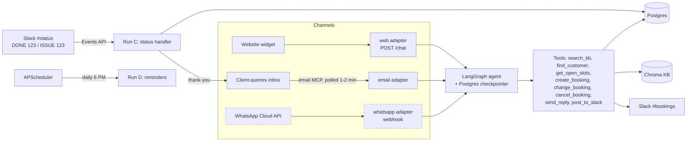
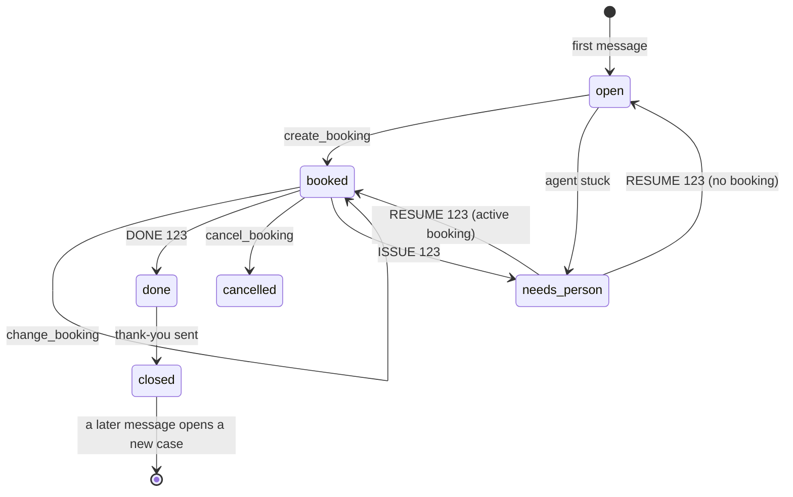

# Speed-to-Lead: Project Plan (Chatbot, Email and WhatsApp)

Source: *Speed-to-Lead Scope: Chatbot, Email and WhatsApp* (Oct 14, 2026, Muhammad Siraj).
This file is the working plan for building it. It restates the scope, then turns it into
schemas, interfaces, folder layout, milestones and checks. Anything marked **(proposed)** is an
implementation choice added here; the scope doc doesn't specify it.

---

## 0. Summary

- **Phase 1:** a website chatbot and an email agent that share one booking core.
- **Phase 2:** the business's WhatsApp, connected to the same core.
- **Out of scope for both phases:** phone calls and voice, Facebook and Google ad leads, automatic nudges to customers who go quiet, approval gates for late changes, and more than one business. Each can be added later on the same core.

Core principles:

1. **One core, thin adapters.** Every channel turns its input into one message shape and calls the same agent, tools and database. A failure in one channel doesn't take down the others.
2. **The AI talks; code acts.** Case status changes, recipients, confirmations and safety text all come from fixed code paths, never from the model.
3. **Everything is idempotent.** Every inbound message, email and Slack post is stored by its provider ID, so it's processed only once.
4. **Every failure ends with a person informed,** usually through Slack.

---

## 1. Phases and scope

| Capability | Phase 1: website chatbot | Phase 1: email agent | Phase 2: WhatsApp |
|---|---|---|---|
| Answers questions from the knowledge base | Yes | Yes | Yes |
| Books a visit | Yes | Yes | Yes |
| Collects name, phone, email, address, problem | Yes | Yes (email is known) | Yes (phone is known) |
| Sends the booking confirmation | By email | By email, in the same thread | In WhatsApp, plus email if given |
| Changes or cancels a booking | No: points the customer to email | Yes, with sender checks | Yes, because WhatsApp confirms the number |
| Posts new bookings to Slack | Yes | Yes | Yes |
| Reads job status from Slack and sends a thank-you | Through the email agent | Yes | Yes |
| Reminder the day before | By email | By email | In WhatsApp, as an approved template |

---

## 2. Architecture



Each channel adapter normalises input to:

```python
class InboundMessage(TypedDict):
    channel: Literal["web", "email", "whatsapp"]
    customer_id: int | None
    case_id: int | None
    text: str
    thread_id: str          # LangGraph thread: chat session / case / phone number
    verified: bool          # web=False; email=sender is the booking's address; whatsapp=True
    provider_msg_id: str    # for dedupe
    attachments: list[Attachment]
```

The adapter also sets **which tools the agent may use** (see section 3.3).

### 2.1 One booking, end to end (14 steps)

| # | Lane | Step |
|---|---|---|
| 1 | Customer | Asks a question in the website chat |
| 2 | Website | Chat adapter opens a session thread |
| 3 | Agent | Answers questions with `search_kb` |
| 4 | Customer | Asks for a visit; gives phone and email |
| 5 | Agent | Offers 3 times, books it: Case #123 |
| 6 | Email | Confirmation email, subject `[Case #123]` |
| 7 | Slack | Bookings channel gets the new job |
| 8 | Agent | Day-before reminder in the thread |
| 9 | Customer | Replies by email: "move it to Friday" |
| 10 | Email | Email adapter matches and verifies |
| 11 | Agent | `change_booking`, replies in the thread |
| 12 | Slack | Technician posts `DONE 123` when finished |
| 13 | Agent | Thank-you email; case #123 closed |
| 14 | Customer | Gets the thanks; a later message opens a new case |

Steps 1 to 7 happen in one chat visit. The email thread started at step 6 carries everything after it, so the change and the close land on the same case.

---

## 3. Shared foundation

### 3.1 Customers and cases

- **Customer:** one person with a permanent `customer_id`, found by email, phone or both.
- **Case:** one job or enquiry with its own `case_id`, shown as "Case #123". It opens with the first message about a job and closes after the thank-you.
- **One open case per customer** is the normal rule. A message after a case closes opens a new case under the same `customer_id`.

| Channel | Identity | Trust |
|---|---|---|
| Website chat | Email and phone the visitor types | Not verified: enough to book, not to change a booking |
| Email | Sender address matches the booking's email (no headers for DKIM/DMARC, section 6.5) | Verified when it matches |
| WhatsApp | Sender's phone number | Verified by WhatsApp |

### 3.2 Knowledge base (RAG) — built

**Decision (changed from the scope doc):** the KB lives in **Chroma** (local persistent store at `backend/data/chroma`), not a pgvector table. Embeddings use **OpenAI `text-embedding-3-large`** (3072 dimensions) for both ingestion and retrieval, through one shared function (`rag/embeddings.py:get_embeddings`).

- **Content:** `backend/knowledge/mdcold/*.md` (overview, contact and service areas, hours, services, brands, pricing and plans, FAQs, policies, booking and financing, trust, other). Each file has a YAML front-matter block (`title`, `category`, `source_urls`, `last_scraped`). `_meta/` is not ingested.
- **Ingest** (`python -m backend.rag.ingest`):
  1. **Load + metadata** (`rag/loader.py`): parse front matter, hash each file.
  2. **LLM chunking** (`rag/chunking.py`, prompts in `rag/prompts/`): one call per document using the chunking rules (one chunk per FAQ, per service heading, per plan, intact price tables, one hours chunk, one service-area chunk per region…, 150–400 tokens, context header `[Business: MD Cold Services | Category: … | Topic: …]`, customer search keywords). Code then sets the header, IDs (`<category>_<topic-slug>_<n>`) and document metadata, so those never depend on the model.
  3. **Checks** (`rag/validation.py`, no LLM): every price, phone, email, URL, license number, percentage and count in a document must appear in its chunks; no chunk may contain a value that isn't in its document; every FAQ question must appear verbatim; token sizes. A document that fails is re-chunked with the problems as feedback (up to 3 attempts). Embedding is refused while checks fail (override with `--force`).
  4. **Report** (`rag/report.py`): `build/report.md` with the FINAL CHECKS (counts, coverage, oversize, unclear chunks) and `build/eval_questions.json` (20 test questions with expected chunk IDs).
  5. **Embed + store** (`rag/vectorstore.py`): header + content + keywords are embedded; the stored document is header + content. Upserts only new or changed chunks (content hash), deletes chunks that disappeared.
  - Unchanged documents are not re-chunked (`build/manifest.json` holds source hashes and a chunker version).
- **Answer:** `search_kb(query, k=4, min_score, where)` returns passages above the cosine-similarity threshold, best first; `format_passages()` renders them for the prompt. Metadata filters are available (`category`, `service_type`, `emergency`, `source_doc`).
- **Not found:** an empty result means the agent says it doesn't know, then offers to book a visit or gives the phone number.
- **Threshold:** `KB_MIN_SCORE` defaults to 0.35 (text-embedding-3-large scores are lower than older models); `python -m backend.rag.evaluate` reports hit@1, hit@k, MRR and suggests a value from real vs off-topic questions.
- **Graph use:** Run A calls `backend.rag.search_kb_multi` through its deps.

### 3.3 Agent core and tool permissions

One LangGraph agent handles every channel. Tools available per channel:

| Tool | Chatbot | Email | WhatsApp |
|---|---|---|---|
| `search_kb` | Yes | Yes | Yes |
| `find_customer`, `get_open_slots` | Yes | Yes | Yes |
| `create_booking` | Yes | Yes | Yes |
| `change_booking`, `cancel_booking` | No | Only if the sender is verified | Yes |
| `send_reply` (this conversation only) | Yes | Yes | Yes |
| `post_to_slack` | Yes | Yes | Yes |

Status changes **never** come from the AI. They happen inside fixed functions:
`create_booking` → `booked`; the Slack status handler → `done`; the thank-you step → `closed`.

**Tool signatures (proposed):**

```python
search_kb(query: str) -> list[Passage]                      # top 4 + scores
find_customer(email: str | None, phone: str | None) -> CustomerRef | None
get_open_slots(preferred: str | None, service: str) -> list[Slot]   # up to 3, near preference
create_booking(slot_id, service, name, phone, email, address, problem) -> BookingResult
change_booking(booking_id, new_slot_id) -> BookingResult    # case/sender bound from state, not args
cancel_booking(booking_id, reason: str) -> BookingResult
send_reply(text: str) -> None                               # recipient and thread filled in by code
post_to_slack(kind: Literal["booking","change","cancel","urgent","needs_person"]) -> None
```

The tools read `case_id`, `customer_id` and `verified` from **graph state**, never from model arguments, so a fooled model can't act on another case.

### 3.4 Database tables

| Table | Holds |
|---|---|
| `customers` | customer_id, name, email, phone, address |
| `cases` | case_id, customer_id, status, channel it started on, email_thread_id, timestamps |
| `bookings` | booking_id, case_id, slot, service, address, reminded, technician, pending change (offered slots + when) |
| `slots` | Open times (or the client's booking software later) |
| `messages` | Every message in and out, with channel and provider IDs (dedupe) |
| ~~`kb_chunks`~~ | Not in Postgres: the KB lives in Chroma (section 3.2) |
| `slack_events` | Status messages already handled (dedupe) |

**DDL sketch (proposed, written as Alembic migrations):**

```sql
CREATE EXTENSION IF NOT EXISTS vector;

CREATE TABLE customers (
  customer_id  BIGSERIAL PRIMARY KEY,
  name         TEXT,
  email        CITEXT UNIQUE,
  phone        TEXT UNIQUE,            -- E.164, e.g. +923001234567
  address      TEXT,
  opted_out    BOOLEAN NOT NULL DEFAULT false,   -- WhatsApp STOP
  created_at   TIMESTAMPTZ NOT NULL DEFAULT now()
);

CREATE TYPE case_status AS ENUM ('open','booked','done','closed','cancelled','needs_person');

CREATE TABLE cases (
  case_id          BIGSERIAL PRIMARY KEY,
  customer_id      BIGINT NOT NULL REFERENCES customers,
  status           case_status NOT NULL DEFAULT 'open',
  channel          TEXT NOT NULL,             -- web | email | whatsapp
  email_thread_id  TEXT UNIQUE,
  wa_last_inbound  TIMESTAMPTZ,               -- 24-hour window (phase 2)
  created_at       TIMESTAMPTZ NOT NULL DEFAULT now(),
  updated_at       TIMESTAMPTZ NOT NULL DEFAULT now(),
  closed_at        TIMESTAMPTZ
);
-- one open case per customer
CREATE UNIQUE INDEX one_open_case ON cases(customer_id)
  WHERE status IN ('open','booked','needs_person');

CREATE TABLE slots (
  slot_id    BIGSERIAL PRIMARY KEY,
  starts_at  TIMESTAMPTZ NOT NULL,
  ends_at    TIMESTAMPTZ NOT NULL,
  technician TEXT,
  taken      BOOLEAN NOT NULL DEFAULT false
);

CREATE TABLE bookings (
  booking_id  BIGSERIAL PRIMARY KEY,
  case_id     BIGINT NOT NULL REFERENCES cases,
  slot_id     BIGINT NOT NULL REFERENCES slots,
  service     TEXT NOT NULL,
  address     TEXT NOT NULL,
  problem     TEXT,
  technician  TEXT,
  reminded    BOOLEAN NOT NULL DEFAULT false,
  active      BOOLEAN NOT NULL DEFAULT true,
  pending_slot_ids  BIGINT[],                 -- times offered for a change; not held
  pending_since     TIMESTAMPTZ,              -- NULL = no change in progress
  created_at  TIMESTAMPTZ NOT NULL DEFAULT now()
);
CREATE UNIQUE INDEX one_active_booking_per_slot ON bookings(slot_id) WHERE active;
CREATE UNIQUE INDEX one_active_booking_per_case ON bookings(case_id) WHERE active;

CREATE TABLE messages (
  message_id       BIGSERIAL PRIMARY KEY,
  case_id          BIGINT REFERENCES cases,
  channel          TEXT NOT NULL,
  direction        TEXT NOT NULL,            -- in | out
  provider_msg_id  TEXT,
  body             TEXT,
  meta             JSONB,
  created_at       TIMESTAMPTZ NOT NULL DEFAULT now(),
  UNIQUE (channel, provider_msg_id)
);

-- kb_chunks: not needed, the knowledge base is stored in Chroma (section 3.2)

CREATE TABLE slack_events (
  event_id    TEXT PRIMARY KEY,            -- Slack event_id / message ts
  case_id     BIGINT,
  command     TEXT,
  handled_at  TIMESTAMPTZ NOT NULL DEFAULT now()
);
```

The partial unique indexes enforce "the same booking twice gives one booking" and "a taken time raises an error" at the database level, not just in code.

---

## 4. Case lifecycle



- Every arrow is a function or a Slack command, never a model decision.
- `needs_person` is the safe stop: the AI stops replying on that case until someone in the office decides what comes next, either by handling it by hand or with `RESUME 123` in Slack (section 6.6), which returns the case to `booked` if it has an active booking, otherwise `open`.
- A reschedule keeps the case `booked`. The change in progress lives on the booking (`pending_slot_ids`), not in the case status, so reminders and `DONE 123` keep working.
- **(proposed)** Implement this as a single `cases.transition(case_id, to, reason)` that checks an allowed-transitions table and writes an audit row. Every status write goes through it.

---

## 5. Channel 1: website chatbot (Phase 1)

### 5.1 Booking flow

1. The visitor asks a question or says what they need; the agent answers from the KB.
2. When they want a visit, the agent collects name, phone, email, address, the problem and a preferred day or time, asking for **one or two items at a time**, not a form.
3. **Code** validates the details: the email format, and the phone normalised to E.164 (`03001234567` → `+923001234567`, using the `phonenumbers` library with region PK).
4. The agent offers **up to three** open times near the requested one.
5. It reads back a summary (service, time, address) and waits for a **clear yes**.
6. `create_booking` saves the booking and sets the case to `booked`.
7. A confirmation email goes out from the business inbox. Subject: `[Case #123] Your AC cleaning visit on Thu 16 Oct, 11:00 AM`. It lists the details and says "reply to this email to change or cancel."
8. The chat shows the confirmation and the case number.
9. The booking is posted to Slack #bookings.

Because the confirmation comes from the inbox the email agent watches, a customer's reply lands in a thread that's already linked to the case.

### 5.2 Conversation memory

- One LangGraph thread per chat session (a `session_id` the widget keeps in `sessionStorage`).
- When the email or phone matches an existing customer, the case is linked to that customer, but the chat **never reveals** that customer's other bookings.

### 5.3 What it refuses

| Request | Reply |
|---|---|
| Change or cancel a booking | "Please reply to your confirmation email for Case #123 and we'll take care of it there." |
| A price not in the KB | "The technician will confirm the exact price on site." |
| A diagnosis, or advice on repairing it themselves | Offers a visit instead |
| Card or payment details | Never asks for or accepts them |
| Anything unrelated to the business | Brings the conversation back politely |

### 5.4 Emergencies

Keywords such as gas smell, sparks, smoke or flooding (checked by **code** in the `guard` node, before the model) stop the booking flow. The chat shows the **approved** safety message and the phone number, and an urgent alert goes to Slack.
**(proposed)** Keep the keyword list in config, with English, Urdu and Roman Urdu variants.

### 5.5 Failures

- **Model down:** the widget shows a short form (name, phone, email, problem). It saves a `needs_person` case and posts to Slack.
- **Confirmation email fails:** retried once; the chat still shows the case number; Slack alert: "confirm by phone".
- **No open times:** the agent says the office will email a time; the case goes to Slack as `needs_person`.

### 5.6 Widget

- `widget/src/widget.js`: a dependency-free script embedded with `<script src=".../widget.js" data-client="..."></script>`.
- It calls `POST /chat` with `{session_id, text}` and gets back `{reply, case_id?, fallback_form?: bool}`.
- **(proposed)** Allow only the business's site origin through CORS, and rate-limit per session and IP.

### 5.7 Acceptance checks

- [ ] A question about hours or area is answered from the knowledge base
- [ ] A question the KB can't answer gets "I don't know" plus an offer to book
- [ ] A full booking ends with a booking in the DB, a confirmation email, a case number in chat and a Slack post
- [ ] An invalid email or phone is caught and asked for again
- [ ] "Can I move my visit?" is pointed to the confirmation email, and nothing changes
- [ ] "Gas smell" shows the safety message and phone number, with no booking flow
- [ ] With the model switched off, the fallback form appears and reaches Slack

---

## 6. Channel 2: email agent (Phase 1)

### 6.1 Waking up

The email MCP can read and send but doesn't announce new mail. An APScheduler job runs **every 1 to 2 minutes** (`max_instances=1`, so two polls never overlap) and handles new emails **oldest first**. Push notifications (Gmail watch or Graph subscriptions) can replace polling later.

**Gmail MCP tools used** (Klavis, 10 offered): `gmail_search_emails` (candidates), `gmail_read_email` (returns the whole thread), `gmail_send_email` (with `threadId` for replies), `gmail_modify_email` (remove `UNREAD`). The server returns **no raw headers** (no `Authentication-Results`, `Auto-Submitted`, `List-Unsubscribe`, `Reply-To` or `Message-ID`) and has **no label create/list tool**, which shapes 6.1, 6.2 and 6.5 below.

**What counts as new is not the unread flag.** Someone in the office opening the inbox would mark an email read and hide it from the agent. The poll searches `EMAIL_POLL_QUERY` (inbox, last 3 days, not from us, Primary only) and skips any Gmail message ID already in `messages`. **Every email looked at is stored by ID**, so it's read once: handled ones with their case, ignored ones with only the reason (no content). Handled emails are marked read for tidiness. There's no `ai-handled` label, because the MCP can't create one or look up its ID.

**Order of work per email:** run the turn → send the reply (retried once) → store the inbound and outbound messages → mark read. If the reply can't be sent, Slack gets the reply text to send by hand and the email is still stored: the turn isn't re-run, so a booking is never made twice. If the **AI** fails, nothing is stored and the email is retried next poll (Slack after 3 failures in a row).

**Several emails in one thread between polls** are handled together as one turn with one reply.

### 6.2 Filtering (code, before the AI sees anything)

Only mail meant for the agent is taken: **replies in a case's thread** (or with the case's `[Case #N]` from the case's customer), **mail sent to `EMAIL_AGENT_ADDRESS`**, and **website form emails**. Everything else in the mailbox is ignored, which matters when the inbox is also a personal one (use a plus address like `you+hvac@gmail.com`).

Skip:
- Auto-replies, by sender (`no-reply`, `mailer-daemon`, `postmaster`, `bounce`) or subject ("Automatic reply", "Out of Office", "Undeliverable", "Delivery Status Notification"…), **except** the website form senders below. Headers aren't available (6.1).
- Newsletters: excluded by the poll query (Gmail's Promotions, Social, Updates and Forums categories).
- The business's own outgoing emails (`-from:me`).
- Threads that already got **5 AI replies in the last hour**. These go to a person.

**Emergency check:** the same `guard` as the chatbot (section 5.4) runs on the email text. A match sends the **approved** safety message and phone number as the reply, posts an urgent Slack alert, and skips the AI.

### 6.2.1 Website enquiry form emails

The site's enquiry form emails the same inbox, but from the website's own address (`wordpress@…`, `noreply@…`), with the customer's details in the body ("Name:", "Email:", "Phone:", "Message:").

- `EMAIL_FORM_SENDERS` in config lists those addresses. They pass the filter.
- **Code** parses the customer's name, email, phone and message from the form email (and validates them as in section 5.1 step 3). Replies go to **that parsed email**, starting a new thread with `[Case #N]` in the subject. They never go back to the website address.
- Form enquiries may **ask questions and book**. They can **never change or cancel**: anyone can type any address into a form. Once booked, the confirmation email becomes the verified thread for later changes.
- A form email that can't be parsed goes to a person.

### 6.3 Matching emails to cases (first match wins)

1. **Thread ID** already linked to a case.
2. **`[Case #N]` in the subject**, even in a brand-new email, but only from that case's customer (otherwise a stranger quoting a number could read the case).
3. **Sender with exactly one open case.** This joins the email to the conversation only; it does **not** count for changes or cancellations (section 6.5).
4. **No match:** a new case, under the existing customer if the address is known, otherwise under a new customer.

A reply in the thread of a closed case is handled by what it says: a plain "thanks" gets no reply; a new request opens a new case (the thread moves to it), and the reply carries the new case number.
"Thanks only" is a code check: short, a thanks word, no question or request word. It applies only to closed cases and new mail: on an open case "ok, thanks" may be the yes to a summary.

### 6.4 The conversation

- The agent sees **this case's messages in full**, plus a one-line summary of each past case, never an old case's whole thread.
- It answers from the KB and books with the same steps as the chatbot; phone and address are asked for by email.
- Every reply goes to the **original sender** (or the parsed customer address for form emails), in the **same thread**. The subject stays the thread's own ("Re: …"), since Gmail only keeps a reply in the thread when the subject matches. The case number goes in the signature (and is already in the subject of our confirmation emails). A form enquiry gets a new email with `[Case #N] Your enquiry to …` as the subject.
- After a booking or change, the reply **is** the code-written confirmation (one email, not a reply plus a confirmation).
- A customer who replies days later continues the same conversation: the thread ID finds the case, and the case's LangGraph thread restores everything said before.

### 6.4.1 Emails the agent can't handle

If the agent can't tell what the customer wants, or the request is outside what it may do, the case goes to `needs_person` and Slack gets an alert with the email. **The AI writes nothing to the customer.** The customer gets only a fixed, code-written acknowledgement ("Thanks, we've received your message and a member of our team will reply shortly. Case #123"). From then on the AI stays silent on that case until the office sends `RESUME 123` or handles it by hand.

### 6.5 Changing or cancelling a booking

Allowed when the email comes **from the address on the booking** (the email given in the chat or used to book by email), whether it's a reply or a brand-new email, and the visit is more than 2 hours away. A booking made in the website chat can therefore be changed by email from that same address.

**DKIM/DMARC can't be checked:** the Gmail MCP gives no `Authentication-Results` header, so the sender address is taken as shown; Gmail's own spam filtering drops most forged mail. A DKIM/DMARC check can be added with a Gmail tool that returns headers.

From any other address nothing changes: the agent replies that it couldn't confirm the request, asks them to email from the address they booked with, and posts the case to Slack. Form emails never pass (section 6.2.1). **A change within 2 hours of the visit always goes to a person.**

**The change flow (email):**
1. "I want to update my booking" from the booking's address: the agent replies with the **current booking details** (case, service, time, address, name, phone, email, problem) and asks what to change.
2. The customer says what to change, and the agent **does it at once**, with no extra yes/no:
   - an exact day and time ("Friday at 10 AM") that's open → moved;
   - one of the offered times ("the second one", "Friday 10 AM") → moved;
   - a new address or problem description → changed, same time;
   - a day or time that isn't open, or only a day → up to three closest open times are offered and stored in `bookings.pending_slot_ids` with `pending_since`.
3. **The original booking stands** until the change is made. Offered times are **not held**: a pick is checked again, and if it's gone, new times are offered.
4. On success: the pending fields are cleared, the case stays `booked`, `reminded` resets, the **updated booking details** go to the customer as the reply, and **only after that email is sent** does Slack #bookings get the update (old → new, section 6.6).

**If the customer goes quiet:**
- No reply, original visit more than 24 hours away: nothing happens; the original booking stands and the conversation can continue whenever they reply.
- Original visit within 24 hours and a change still pending: Slack alert ("Case 123 asked to move, no answer, visit tomorrow 10 AM; please call").
- A reply after the original visit time has passed: the pending change is void and the case goes to a person.

### 6.6 Slack

**#bookings:** each new booking, change or cancellation, with the case number, customer, service, time, address and phone. A change shows old → new, for example `🔁 Case #123 rescheduled: Thu 16 Oct 10:00 AM → Fri 17 Oct 2:00 PM`, followed by the full booking details.

**#status:** employees post one line per finished job.

| Message | Effect |
|---|---|
| `DONE 123` | Case 123 → done; a thank-you email goes out in its thread; the case → closed |
| `ISSUE 123 <note>` | Case 123 → needs_person; nothing is sent to the customer |
| `RESUME 123` | Case 123 leaves needs_person (→ booked if it has an active booking, otherwise open); the AI replies again on its next email |
| Anything else | The bot replies with the three formats above |

After acting, the bot replies in the Slack thread ("Case 123 marked done, thank-you sent"). This needs a **Slack app** with `chat:write` and `channels:history` (or `groups:history`) plus an Events API subscription. A posting-only webhook isn't enough.

### 6.7 Reminders

A daily job (6 PM, business time zone) emails a reminder the day before each visit, in the case's thread, and marks the booking `reminded`. It repeats the time and address and says to reply to change or cancel.

### 6.8 Acceptance checks

- [ ] A first email gets a reply within 2 minutes and opens a case
- [ ] Five back-and-forth emails stay on one case, and the booking lands in Slack
- [ ] A new email with `[Case #123]` in the subject joins case 123
- [ ] An out-of-office reply gets no answer
- [ ] A change request from the customer's verified address moves the booking; the customer gets a change confirmation and Slack shows old → new
- [ ] The same request from a different address changes nothing and reaches Slack
- [ ] A change request in a brand-new email from the booking's address (e.g. a chat booking) moves the booking
- [ ] A requested time that's taken gets up to three offers; a reply three days later picks one and the booking moves
- [ ] An offered time taken in the meantime gets fresh offers, and the original booking is untouched
- [ ] A website form enquiry gets a reply at the customer's address (not the website's) and can book, but a change request from a form is refused
- [ ] "I smell gas" by email gets the safety message and an urgent Slack alert, no AI reply
- [ ] An email the agent can't handle gets only the fixed acknowledgement; the case goes to needs_person and Slack; `RESUME 123` hands it back
- [ ] An email opened in Gmail by staff before the poll is still handled; a handled email is never answered twice
- [ ] `DONE 123` in Slack sends the thank-you and closes the case
- [ ] A later email from the same customer opens Case 124 under the same customer
- [ ] Tomorrow's visits get a reminder today, once

---

## 7. Channel 3: WhatsApp (Phase 2)

Reuses the same agent, tools, cases and Slack flow; only a new adapter is built. WhatsApp confirms the sender's number, so customers may book, change and cancel directly in the chat.

**Carries over unchanged:** the KB and every tool; cases, customers, both Slack channels and `DONE 123`; guardrails and failure handling.

**What's new:**
- **Adapter:** the Cloud API webhook (verify token GET plus inbound POST with signature check) and the send endpoint for replies. Message IDs are stored, so retries are ignored.
- **Identity by phone:** the number finds the customer. A customer who first booked by email is matched if their phone is on file; otherwise a new customer is created and the office can merge them later.
- **24-hour window:** free-form replies only within 24 hours of the customer's last message. Anything later must use a **Meta-approved template**.
- **Templates to prepare:** the day-before reminder, the thank-you after DONE, and "the office will contact you".
- **Photos and voice notes:** photos are saved to the case and posted to Slack; a voice note gets a polite request to type the message.
- **Language:** replies follow the customer: English, Urdu or Roman Urdu.
- **Opt-out:** "STOP" ends all messages to that number (`customers.opted_out`).

**Setting up the number:** this needs a Meta business account and the WhatsApp Business Platform. During development, Meta allows messages only to numbers added as testers. Check early whether the current number can stay on the WhatsApp Business app while connected to the API; if not, use a new number for the agent.

**Acceptance checks**
- [ ] A WhatsApp question is answered from the KB
- [ ] A full booking over WhatsApp lands in the DB and in Slack
- [ ] A customer can move a booking in WhatsApp, and Slack shows the change
- [ ] `DONE 123` sends the thank-you as a template when the 24-hour window has closed
- [ ] The day-before reminder arrives as a template
- [ ] A photo reaches Slack #bookings with its case number
- [ ] STOP ends all further messages

---

## 8. Guardrails and failure handling

The tools are limited so tightly that a fooled model can only send a bad reply. It can never lose, double or wrongly close a booking.

### 8.1 Guardrails

- **Customer text is data, never instructions.** The prompt says so, and more importantly, no tool can do what an email might demand: there's no forward tool and no way to send to an address the AI chooses.
- **Replies go to the sender only.** `send_reply` takes the conversation, not an address; code fills in the recipient and thread. The one exception, website form emails, uses the customer address that **code** parsed from the form, never one the model chose.
- **Status changes live in code** (`booked`, `done`, `closed`, `cancelled`).
- **Changes need a verified sender.** Email: sent from the booking's email address. Website form: never. Chat: never. WhatsApp: the verified number.
- **Prices come from the KB only.** No unapproved discounts or quotes.
- **Fixed safety wording** for emergencies.
- **Loop and flood limits:** automatic emails are skipped; at most 5 AI replies per thread per hour.
- **Code writes confirmations.** "You are booked for…" is a template filled in after `create_booking` succeeds.

### 8.2 Failures

| Failure | What happens | Who learns of it |
|---|---|---|
| AI model down or too slow | Chat shows the fallback form; email and WhatsApp wait and are retried next run | Slack, after 3 failures in a row |
| Confirmation email not sent | Retried once; the chat still shows the case number | Slack: "confirm by phone" |
| Email MCP unreachable | Polling retries next run; emails stay unread, so nothing is lost | Slack, if it fails for 10 minutes |
| No open times | Customer told the office will send a time | Slack, case marked needs_person |
| Chosen time taken meanwhile | New times offered | Nobody needs to |
| Sender not verified for a change | Nothing changes; customer asked to reply from their registered address | Slack |
| DONE for an unknown or unbooked case | Nothing changes; the bot explains in Slack | The employee who posted |
| Duplicate email, WhatsApp message or Slack post | Ignored by its stored ID | Nobody needs to |
| A message the agent can't handle | Case → needs_person; only the fixed acknowledgement is sent; the AI stops replying on it until `RESUME` | Slack |
| Reply sent but labelling fails | Next tick sees the stored message ID and doesn't reply again | Nobody needs to |
| Change pending, no answer, visit within 24 hours | Original booking stands | Slack: "please call" |
| Website form email can't be parsed | Nothing sent | Slack, case needs_person |

---

## 9. Tech stack

| Part | Choice | Notes |
|---|---|---|
| Agent | LangGraph + Postgres checkpointer | One thread per chat session, email case or WhatsApp number |
| Backend | FastAPI | Chat endpoint, WhatsApp webhook, Slack events, health check |
| Database | Postgres (app data) | Neon free plan for the demo; pgvector no longer required |
| Knowledge base | Chroma + OpenAI `text-embedding-3-large`; LLM chunking with `gpt-4.1` | `python -m backend.rag.ingest` when documents change |
| AI model | Small, fast, tool-calling | Groq or Google AI Studio free tiers for the demo |
| Chat widget | Small embeddable script | Calls the chat endpoint |
| Email | Email MCP on the client-queries inbox | Polled every 1 to 2 minutes |
| Slack | Slack app: post to #bookings, read #status | A webhook alone can only post |
| Scheduler | APScheduler inside the app | Email polling and daily reminders |
| WhatsApp (phase 2) | WhatsApp Cloud API | Webhook in, send endpoint out, templates outside 24 hours |

The agent server must be able to reach the email MCP. If the MCP runs only on someone's laptop, move it to the agent's server before going live.

### 9.1 Dependencies vs the current `backend/pyproject.toml`

Already present: `fastapi`, `uvicorn`, `langgraph`, `langchain`, `langchain-groq`, `langgraph-checkpoint-postgres`, `psycopg[binary]`, `psycopg-pool`, `mcp`, `langchain-mcp-adapters`, `python-dotenv`, `jinja2` (email templates).

Added for the RAG pipeline: `langchain-openai`, `chromadb`, `tiktoken`, `pydantic-settings`, `pytest` (dev).

Still to add **(proposed)**: `sqlalchemy`, `alembic`, `apscheduler`, `slack-sdk` (or `slack-bolt`), `phonenumbers`, `email-validator`, `httpx`, `tzdata`, and for tests `pytest-asyncio`, `respx`.

Probably remove (not used by this project): `airportsdata`, `pycountry`, `langchain-tavily`, `tavily-python`, `nest-asyncio`.

---

## 10. Repository layout

This is the layout as it exists on disk. `backend/` is the uv project; the Python package is `backend/src/backend/` (src layout).

```
hvacX/
├── README.md
├── docker-compose.yml               # Postgres for local dev
├── .gitignore
├── docs/
│   ├── plan.md                      # this file
│   └── Speed-to-Lead Scope Chatbot, Email and WhatsApp.docx
└── backend/
    ├── pyproject.toml / uv.lock / requirements.txt / .python-version
    ├── .env  (git-ignored)  ·  .env.example
    ├── knowledge/mdcold/             # KB source .md files (business docs)
    │   ├── 00_business_overview.md … 10_other.md, 03_services/, 04_products/
    │   ├── _meta/99_coverage_report.md   # crawl report; NOT ingested
    │   └── build/                    # chunks, checks report, eval reports (generated)
    ├── data/chroma/                  # vector store (git-ignored)
    ├── scripts/                      # seed_demo_client, chat_cli, list_mcp_tools,
    │                                 #   send_pending_notifications
    ├── tests/
    │   ├── conftest.py
    │   ├── graphs/test_run_a_chat.py
    │   └── rag/                      # offline pipeline tests + dataset_eval.json
    └── src/backend/
        ├── main.py                   # FastAPI app: routers
        ├── config.py                 # pydantic-settings
        ├── core/                     # errors, timeutil
        ├── api/                      # chat, health, dev (test console)
        ├── schemas/chat.py           # API request/response models
        ├── static/test_console.html  # dev test console (DEV_UI=true)
        ├── graphs/
        │   ├── common/               # state, checkpointer, llm
        │   ├── run_a_chat/           # graph, nodes, deps, schemas, prompts/   (built)
        │   └── run_b_email/          # graph, nodes, deps, mail (rules), poller (built)
        ├── tools/                    # booking, customers, cases, notify, guardrails, validation
        ├── rag/                      # loader, chunking, validation, report, embeddings,
        │                             #   vectorstore, ingest, retriever, evaluate, evaluate_qa, prompts/
        ├── mcp/                      # client, email_mcp, slack_mcp (Klavis)
        ├── db/                       # schema.sql, session, init_db
        └── templates/                # email/*.j2, safety_message.txt
```

`scheduler.py` runs the inbox poll (APScheduler). Packages for later runs (`run_c_slack_status/`, `run_d_reminders/`, `run_e_whatsapp/`, the embeddable `widget/`) are added when each is built.

Where code goes:
- `api/` only parses requests and calls a graph or channel adapter; no business logic.
- `tools/cases.py` is the only place that writes `cases.status`.
- `knowledge/` holds content; `src/backend/rag/` holds the code that reads it.

**MCP services already configured in `.env`:** Gmail and Slack through Klavis Strata MCP, Calendly through Composio. That partly answers open question 1 (the inbox is on Gmail).

**Note on multi-tenancy:** the scope doc's tree includes `tenants/resolver.py` and `client_id` on all tables, but "more than one business" is out of scope. **(proposed)** For now, add a nullable `client_id` column and skip the resolver, so multi-tenant support can come later without a migration rewrite. Decide this before step 1.

---

## 11. Agent runs (LangGraph)

Five runs, each with its own trigger. They never call each other and share work only through the database. Only three nodes call the AI (the `agent` nodes in A, B and E).

| Run | Started by | How often | Memory (thread) | AI |
|---|---|---|---|---|
| A | A visitor sends a chat message | Every message | One per chat session | Yes |
| B | Timer checks the inbox through the email MCP | Every 1 to 2 minutes | One per case | Yes |
| C | An employee posts in Slack #status | Every post (Slack event) | None | No |
| D | Daily timer | Once a day, 6 PM | None | No |
| E | WhatsApp message reaches the webhook (phase 2) | Every message | One per phone number | Yes |

The email timer sets how long a customer waits: at 15 minutes, each reply could take up to 15 minutes. A check that finds no new mail uses no AI, so polling every 1 to 2 minutes costs almost nothing.

### Run A: chat message

| Node | Kind | What it does | If it fails |
|---|---|---|---|
| guard | Code | Checks for emergency words; on a match → safety_reply | |
| safety_reply | Person alerted | Safety message + phone; urgent Slack alert | |
| load_session | Code | Restores the chat; links the customer on email/phone match, without showing other bookings | |
| agent | AI | Answers, asks for a detail, offers times, or calls a tool | Model down → fallback_form |
| tools | Code | search_kb, get_open_slots, create_booking (which also sends the confirmation email and Slack post) | Time taken → new times offered |
| respond | Code | Sends the reply to the chat window | |
| fallback_form | Person alerted | Short form; saves a needs_person case; Slack alert | |

### Run B: email timer

`fetch_unread` runs once per tick; the rest runs once per email, oldest first.

| Node | Kind | What it does | If it fails |
|---|---|---|---|
| fetch_new | Code | `EMAIL_POLL_QUERY` results not in `messages`, read per thread (one turn per thread) | MCP unreachable → retry next tick; Slack after 10 min |
| filter | Code | Only mail for the agent (case thread, agent address, form sender); skips auto-replies; >5 AI replies/hr → person | Over the limit → needs_person |
| parse_form | Code | Form emails only: extracts and validates the customer's name, email, phone, message | Unparseable → needs_person |
| guard | Code | Emergency words → safety_reply | |
| safety_reply | Person alerted | Approved safety message + phone; urgent Slack alert | |
| match_case | Code | Thread ID → [Case #N] → single open case → new case; a case in needs_person stops here | |
| verify_sender | Code | Sender is the case's customer (booking email) → `verified`; form emails never | Not verified → change tools withheld |
| agent | AI | This case in full + one-line past-case summary + any pending change | Model down → email stays unlabelled for the next tick |
| tools | Code | As Run A + change/cancel when verified (offers stored as pending; within 2 hours → person) | Time taken → new times offered |
| reply | Code | To the sender (or parsed form address), same thread, keeps [Case #N] | |
| mark_handled | Code | After the send: stores the message IDs, marks read | Send fails twice → Slack: reply by hand |
| needs_person | Person alerted | Fixed acknowledgement only; AI stops on this case until `RESUME`; Slack alert | |

### Run C: Slack status

| Node | Kind | What it does | If it fails |
|---|---|---|---|
| parse | Code | `DONE 123`, `ISSUE 123 <note>` or `RESUME 123` | Other text → help_reply |
| validate_case | Code | Case exists, is booked, post not handled before | Invalid → reason posted in Slack |
| mark_done | Code | Case → done | |
| send_thanks | Code | Thank-you in the email thread, or a WhatsApp template | Send fails → Slack: thank by phone |
| close_case | Code | Case → closed | |
| confirm_slack | Code | "Case 123 marked done, thank-you sent" in the thread | |
| needs_person | Person alerted | ISSUE: case → needs_person; nothing sent to the customer | |
| resume | Code | RESUME: needs_person → booked (active booking) or open | Case not in needs_person → reason posted |
| help_reply | Code | Replies with the three accepted formats | |

Slack requires a 200 response within 3 seconds, so the endpoint acknowledges immediately and runs C in a background task.

### Run D: daily reminders

| Node | Kind | What it does | If it fails |
|---|---|---|---|
| find_tomorrow | Code | Booked visits tomorrow, not reminded, in the business time zone | |
| send_reminder | Code | Time, address, "reply to change or cancel", by email thread or WhatsApp template | Send fails → Slack: remind by phone |
| mark_reminded | Code | Never reminds twice | |
| stale_changes | Code | Bookings tomorrow with a change still pending → Slack "please call" | |

### Run E: WhatsApp message (phase 2)

| Node | Kind | What it does | If it fails |
|---|---|---|---|
| dedupe | Code | Stops if this message ID was handled before | |
| guard | Code | STOP → opt out and end; emergency words → safety reply + urgent Slack | |
| identify | Code | Customer by phone + open case, or opens one | |
| agent | AI | As Run A, with change and cancel allowed | Model down → "we'll reply shortly" + Slack |
| tools | Code | The full set | |
| respond | Code | Free text within 24 hours, otherwise an approved template | |

---

## 12. Build order (milestones)

Build one working slice at a time; **don't start the next step until its check passes.**

| # | Step | Tasks | Check |
|---|---|---|---|
| 0 | **Project setup** (proposed) | Clean up deps; `config.py`; `.env.example`; docker-compose with pgvector; pytest; FastAPI `/health` | `uvicorn` starts; `/health` returns 200 and pings the DB |
| 1 | **Database + demo data** | Alembic migration for the tables in 3.4; `seed_demo_client.py` with a made-up HVAC business, customers, a week of slots | The seed shows customers and a week of slots |
| 2 | **Knowledge base** ✅ built | LLM chunking with fact checks, Chroma + `text-embedding-3-large`, `search_kb`, 20-question eval | `python -m backend.rag.evaluate` shows the right passages for the test questions |
| 3 | **Booking tools** | `find_customer`, `get_open_slots`, `create_booking`, `change_booking`, `cancel_booking`, `cases.transition`, with unit tests | Booking the same thing twice gives one booking; a taken time raises an error |
| 4 | **Chatbot agent in the terminal** | Run A graph, prompts, guard, phone/email validation, refusal rules, a CLI loop | A typed conversation answers questions and books a visit |
| 5 | **Chat widget + confirmation email** | `POST /chat`; `widget.js` on a demo page; confirmation template sent from the business inbox via the email MCP | A booking on the page produces the email with `[Case #N]` in the subject |
| 6 | **Slack #bookings** | Slack app; `post_to_slack` for booking/change/cancel/urgent/needs_person | Every booking appears in Slack with its case number |
| 7 | **Email agent: read + reply** ✅ built | Polling job (message-ID based, not unread), filters, emergency guard, website form parsing, case matching, answering only (no booking), needs_person with fixed acknowledgement | Replies arrive within 2 minutes; an out-of-office gets none; a form enquiry is answered at the customer's address |
| 8 | **Email agent: booking + changes** ✅ built | Booking over email; thread + sender check; change/cancel with the sender checks; pending offers; change-confirmation template; Slack old → new; the 2-hour rule | The section 6 checks for booking and changes pass |
| 9 | **Slack status loop + reminders** | Events endpoint, Run C (DONE / ISSUE / RESUME), thank-you template, Run D at 6 PM with the stale-change alert | `DONE 123` closes the case and the customer gets the thank-you |
| 10 | **Demo run** | `demo_reset.py`; scripted story: chat booking → email change → DONE → thank-you | Runs twice in a row without touching code |
| 11 | **WhatsApp (phase 2)** | Meta setup, webhook, adapter, templates, 24-hour logic, media, STOP, language | A real phone books, changes and gets the thank-you |

### 12.1 Testing strategy (proposed)

- **Unit:** tools, `cases.transition`, filters, case matching, form parsing, phone normalisation, the template renderers.
- **Graph tests:** each run with fake tools and a scripted fake LLM, so tests are deterministic and need no network.
- **RAG eval:** 30 questions with expected source passages; track hit@4 and "I don't know" accuracy.
- **Fixtures:** real-shaped sample emails (out-of-office, form email, quoted reply, `[Case #N]` subject), Slack event payloads and WhatsApp webhooks.
- **Acceptance:** each checklist in sections 5.7, 6.8 and 7 becomes a test or a scripted manual run.

---

## 13. Configuration (`.env.example`, proposed)

```
DATABASE_URL=postgresql://...
LLM_PROVIDER=groq
GROQ_API_KEY=
LLM_MODEL=
RAG_EMBEDDING_MODEL=text-embedding-3-large
RAG_CHUNKER_MODEL=gpt-4.1
CHROMA_DIR=data/chroma
CHROMA_COLLECTION=mdcold_kb
BUSINESS_NAME=
BUSINESS_PHONE=
BUSINESS_TZ=Asia/Karachi
BUSINESS_INBOX=
EMAIL_MCP_URL=
EMAIL_POLL_SECONDS=90
REMINDER_HOUR=18
LATE_CHANGE_HOURS=2
MAX_AI_REPLIES_PER_THREAD_PER_HOUR=5
KB_TOP_K=4
KB_MIN_SCORE=0.35
SLACK_BOT_TOKEN=
SLACK_SIGNING_SECRET=
SLACK_BOOKINGS_CHANNEL=
SLACK_STATUS_CHANNEL=
SLACK_URGENT_CHANNEL=
WIDGET_ALLOWED_ORIGINS=
# phase 2
WA_PHONE_NUMBER_ID=
WA_ACCESS_TOKEN=
WA_VERIFY_TOKEN=
WA_APP_SECRET=
```

---

## 14. Open questions (from the scope doc)

- [ ] Is the client-queries inbox on **Gmail or Outlook**? This decides how senders are verified and whether push can replace polling.
- [ ] Where does the **email MCP** run, and can the agent server reach it?
- [ ] What happens after an employee posts in Slack #status, beyond DONE and ISSUE? (The earlier message describing this was cut off.)
- [ ] Who in the office handles **needs_person** cases and urgent alerts, and in which Slack channel?
- [ ] Is **2 hours** before a visit the right late-change limit?
- [ ] Which documents form the **knowledge base**, and who keeps the price list current?
- [ ] What time should the **daily reminder** go out? (Run D currently says 6 PM.)
- [ ] For WhatsApp: can the current number stay on the WhatsApp Business app while connected to the API, or does the agent need a new number?

Added by this plan:
- [ ] Single tenant now, or `client_id` everywhere from day one? (section 10)
- [x] Which embedding model? OpenAI `text-embedding-3-large`, stored in Chroma.
- [ ] Which email MCP server: an existing Gmail/Outlook MCP, or our own in `mcp_servers/email_server/` with only reply-to-sender and label tools?

---

## 15. Risks

| Risk | Mitigation |
|---|---|
| Free-tier LLM rate limits or slowness | Fallback form, retry on the next tick, Slack alert after 3 failures; keep the model swappable in `llm.py` |
| Email MCP lacks headers (Authentication-Results, List-Unsubscribe, Auto-Submitted) | **Confirmed in step 7**: Klavis Gmail returns none. Changes rely on the sender address (6.5), auto-replies on sender/subject, newsletters on Gmail categories. Swap in a header-returning Gmail tool to add DKIM/DMARC |
| Small models make unreliable tool calls | Tight prompts, few tools per channel, code-side validation, graph tests with recorded transcripts |
| Meta template approval delays | Submit the three templates as soon as phase 2 starts |
| Double booking under concurrent requests | Partial unique index on active bookings per slot, plus `SELECT ... FOR UPDATE` on the slot |
| Reply loops with other bots | Header filters, own-mail skip, 5 replies per hour per thread cap |
