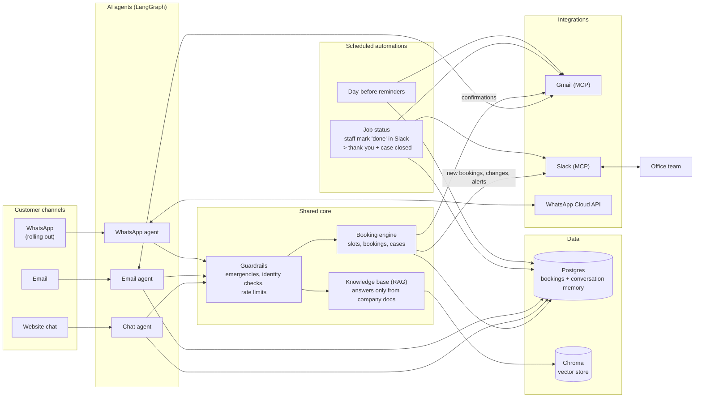

# LinkedIn post: AI front desk for an HVAC business

## System architecture (high level)

> LinkedIn doesn't render Mermaid. To get an image for the post, paste the diagram into
> [mermaid.live](https://mermaid.live) and export it as PNG.

---

## Post

An HVAC company came to us with a simple problem: their office was drowning in repetitive work.

Answering the same questions about prices and service areas. Booking visits by phone and email. Moving appointments. Chasing confirmations. Sending reminders. Thanking customers after each job. Every hour spent on this was an hour not spent on paying work, and every slow reply was a lead that went to a competitor.

Their requirement: answer every customer in seconds, on any channel, without adding staff.

So we built them an AI front desk that now handles:
→ Customer questions in the website chat and by email, answered from the company's own documents
→ Bookings, reschedules and cancellations, end to end
→ Every new booking and change posted to the team's Slack
→ Thank-you emails as soon as staff mark a job done
→ Reminders the day before every visit
→ WhatsApp, rolling out now on the same core

The result: the routine work runs itself. The office handles only what truly needs a person, and the system escalates those cases automatically.

What made it reliable enough for a real business: the AI handles the conversation, but every booking, change and email goes through plain code. It can't double-book a slot or confirm something that didn't happen.

On a 51-question test: 99% correct answers, 0% invented facts.

Built with LangGraph, RAG, MCP (Gmail + Slack), FastAPI and Postgres.

Which repetitive task in your business would you hand to an AI agent first?

#AIAutomation #AIAgents #BusinessAutomation #LangGraph #Productivity
